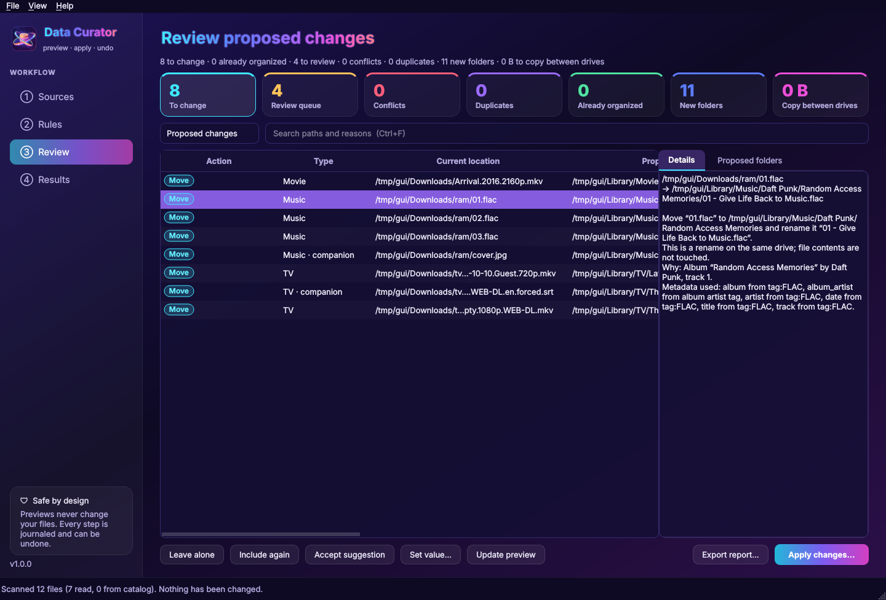

<p align="center"></p>

# Data Curator

A desktop application (and matching command-line tool) that organizes and renames music, TV, movies,
documents and photos into a **minimal, deterministic folder structure** — safely, with a preview,
a durable recovery journal and undo.

```
Choose sources → Choose rules → Scan → Review proposed changes → Apply → View results or undo
```

* **Nothing changes until you apply.** Scanning and preview only read files (verified by tests that
  snapshot every byte and timestamp before and after a preview).
* **Only the folders the rules need.** `Music/Album Artist/Album/01 - Title.flac`,
  `TV/Series/Season 01/Series - S01E01 - Title.mkv`. Disc, year, resolution or episode folders appear
  only when a chosen rule asks for them. Tags, collections, search and the review queue live in the
  catalog, never as extra folders.
* **Deterministic.** The same files and settings always produce the same plan (input is processed in
  sorted order; every tie has a stable rule). Re-running an applied plan proposes no changes.
* **Uncertain files stay put.** Missing album artist, conflicting tags, untagged multi-artist albums,
  bare episode numbers, videos that are neither clearly an episode nor a movie — all go to the
  review queue with a suggested fix. Metadata is never invented.
* **Never overwrites.** No-replace renames on every platform; cross-drive moves copy to a temporary
  name, verify a BLAKE2b hash, finalize atomically and only then remove the original.
* **Works offline.** Embedded tags, filenames and local `.nfo` files. Online enrichment (TVmaze and TMDB) is
  optional, cached, and labelled with its provenance.



The default **Peppermint dark** theme pairs deep burgundy with cream lettering and barber-pole accents.
Choose **View → Peppermint light** for warm cream surfaces and burgundy controls, or **View →
Peppermint dark — burgundy** to switch back. Your choice is remembered across launches.
[Preview the light theme](docs/screenshots/peppermint-light.png). **View → System theme** is also available.
The icon and header are generated by `scripts/make_icon.py`.

## Source folders and category destinations (1.3.2)

The opening setup defaults to **Music**, **TV**, **Movies**, **Documents**, **Photos**,
and **Other files** folders inside each source. Adding or changing sources updates
the displayed destinations. With multiple sources, each source organizes within
itself. Uncheck **Inside source**, or browse, to choose a custom destination.
Folders are created only when you apply the reviewed plan.

**Detect all files** inventories all regular file types, including unknown extensions,
files without extensions, hidden files, subfolders and existing destination folders.
The preview starts at **Everything**, so review items, protected files and already
organized files remain visible. Installed games and application bundles are inventoried
but left in place. Explicit exclusions, links, application working files and OS
housekeeping files are omitted; **Scan details** reports inaccessible folders and
skipped folders or links. An incomplete scan is shown clearly.

Saved profiles retain their destinations and disabled categories. To reset an older
setup, click **Use category folders in sources** on the opening screen. This keeps
the selected sources and enables all categories and the complete file inventory.
Open **Data Curator → About Data Curator…** on macOS (or **Help → About Data Curator…**
on other desktops) for the branded About window, version, and links to releases, source and issues.

## Install

Requires Python 3.11+.

```bash
python -m pip install "datacurator[gui] @ ."        # from this folder
# or for development:
python -m pip install -e ".[gui,dev]"
```

Then run the desktop app with `datacurator` or the CLI with `curator --help`.
Standalone builds (no Python needed) are described in [docs/PACKAGING.md](docs/PACKAGING.md).

## Desktop app

1. **Sources** — add folders (local, removable, mapped drives, UNC paths, mounted shares) or saved
   locations. Category destinations default to named folders inside each source. Uncheck **Inside
   source** for a custom destination; leaving that custom field blank uses the source directly.
   **Check** measures a destination (case sensitivity,
   Unicode behaviour, Windows name rules, links, free space) with a hidden test file.
2. **Rules** — choose a layout preset per category or edit the templates; the example updates as you
   type, including what happens when values are missing. Collision handling and naming preset are
   visible. **Extensions**, **Exclusions**, and **Video metadata** have their own tabs; transfer options are under **Advanced**.
3. **Review** — a virtualized before/after table with search and filters for the review queue,
   conflicts, uncertain matches, duplicates, errors, name adjustments and preservation notes; the
   proposed folder tree; per-file explanations in plain language, including metadata provenance and
   every sanitization. Batch actions: *Leave alone*, *Accept suggestion*, *Set value…* (per file or
   for the whole album/series), *Choose match…* for ambiguous movie/TV lookup results, *Update preview*. Export the plan as CSV/JSON.
4. **Results** — progress with pause/cancel, the run history, undo with a dry-run summary, and
   recovery of interrupted runs (offered automatically on start-up).

Choosing a destination enables its category; you can turn it off again in Rules.
**HEIC / HEIF photos** are supported, including their EXIF capture dates. After upgrading,
choose **Scan and preview** again to retry previously unreadable files, then apply the new plan.
Files without a capture date stay in review unless you set a year/month or choose the modified-time
fallback in Rules → Photos. Enabled Photos and Documents rules take priority over automatic
companion matching for HEIC/HEIF and PDFs in folders containing music or videos.

## Music library

The **Music library** page offers artist/album browsing, sortable track columns, search, and filters
for missing details, unreadable tags and edited tracks. **Scan music library** reads the Sources
without moving files. The main scan/preview also refreshes this view.

- Select tracks (or **Select all shown**) and use **Edit details…** to change several fields together.
  Only checked fields change, so tracks keep their individual titles and numbers when you edit an album.
- **Details from filenames…** previews metadata from an exact pattern such as
  `{album_artist}/{album}/{track} - {title}`. Folder patterns start at the source; omit the extension.
  **Fill missing details only** protects existing values. Accept the displayed suggestions to save
  them for organization; unmatched names stay unchanged. The last filename pattern is remembered.
- Choose a layout and click **Use layout**, then **Scan and preview organization**. Enable
  **Organize inside each source folder** to use each source as its destination. The **Music / Album
  Artist / Album** layout creates a `Music` folder within each source. **Keep filenames** sorts without
  renaming. Genre, format, year/album and multi-disc layouts are also available.
- Details edits are stored locally for organization. To embed them in the audio files, explicitly
  check **Write edited details into audio files when applying**. Those writes appear in the preview
  and use the existing backup/undo workflow. Save your profile to reuse the layout and options.

`profiles/music-in-source.json` provides a music-only starting profile. This workflow is inspired by
[MediaMonkey's file organization](https://www.mediamonkey.com/wiki/WebHelp%3AChanging_Filenames) and
[tag-from-filename preview](https://mediamonkey.com/wiki/WebHelp%3AAuto-Tag_from_Filename).
Online identification, artwork downloads and playback are not included.

## Extension folders and game protections

For a quick mixed-file setup, add your source folders and click **Mixed files: subfolders inside
sources** on the Sources page, then **Scan and preview**. This selects format folders, turns on
photos/documents, clears category destinations, and keeps online lookups off. It preserves your
explicitly excluded folders. **profiles/mixed-in-source.json** provides the same reusable setup. PDFs go to `PDF`, archives to `Archives`,
photos to `Photos/HEIC`, `Photos/JPEG`, etc., music to format/artist/album folders, and videos to
format/movie or format/series/season folders inside each source. Save the profile to reuse it.

In **Rules → Extensions**, enable sorting and edit the extension/folder table. Extensions may
be comma separated, and folders must be relative paths such as `Documents/PDF`. An extension rule
sorts standalone files without changing their filenames. For recognized music/video files it
prefixes the normal category layout; attached cover art, subtitles and other companions stay with
their media. Rename-only music/video layouts keep files in their current folders. Extension rules
for documents/photos take priority over project/date layouts, so no photo date is needed for an
explicit format folder. A category destination, if set, becomes the base for that category's folders.

**Rules → Exclusions** protects installed game folders and `.app` bundles by default, using known
launcher library names and common Steam/GOG/Unity/Unreal markers. Add other game or save-data
folders explicitly. These protections cover scanning, previews from a cached catalog, and duplicate
searches. Scan summaries show the number skipped; hover over the summary for paths and reasons.

## Duplicate finder

Open **Duplicates** (also available under **Tools**), choose all files or a file type, and optionally
choose a folder whose copies should be kept. **Find duplicates** scans the sources, shortlists equal
sizes, and compares exact content hashes. The table shows extra copies, retained copies and the
quarantine destination. Search, select the copies you want to set aside, then **Quarantine selected
copies…**. Files already excluded, game libraries and the quarantine are omitted. Hard links are
left alone. Changed/unreadable files are reported instead of being moved. Empty files are omitted.

The default quarantine is inside Data Curator's application data folder; a custom location can be
chosen. Copies already in quarantine are never overwritten. The retained copy is verified again
before each move. Quarantine moves use the recovery journal and can be undone under **Results**;
permanent deletion is left to you. This finds identical bytes, not similar photos or re-encoded tracks.

## Movie and TV details

Local parsing is the default. Data Curator reads movie years, episode/season/date/absolute numbers,
quality tokens in filenames, matching Kodi-style NFOs, single-video `movie.nfo`, parent `tvshow.nfo`,
and embedded MP4/M4V/MOV title/series/season/episode tags. It gathers plot, runtime, genres and IDs
when supplied locally. Generically named videos can be organized when their sidecar or embedded
tags identify them. Gathered details are visible in **Review → Details** and exported with the plan.
Metadata gathering does not rewrite video contents or generate new sidecars.

Enable **TVmaze** or **TMDB** in **Rules → Video metadata** for optional online enrichment. TMDB
requires your own [API Read Access Token](https://www.themoviedb.org/settings/api); use **Set TMDB
read token…** to save it in the system credential store. The token is never written into a profile;
CLI users may supply `DATACURATOR_TMDB_TOKEN` instead. Online lookup sends parsed names to the
selected service, caches responses for 30 days, and fills missing fields with labelled provenance.
Local values and overrides take priority. An ambiguous name/year stays in Review; select the file
and **Choose match…**, or set `movie_id=tmdb:123` / `series_id=tvmaze:123` as a catalog override.
A lookup failure leaves local organization available and is shown in the file's provenance.

The Movie Database supplies optional movie data. This product uses the TMDB API but is not endorsed
or certified by TMDB. Optional TV metadata is provided by [TVmaze](https://www.tvmaze.com/api).

## Command line

The CLI uses the same engine.

```bash
curator init-profile my.json -s ~/Downloads --music-root ~/Music --tv-root ~/Videos/TV
curator plan -p my.json --show review          # scan + preview; changes nothing
curator explain <plan-id> 12                   # why item #12 is proposed
curator accept <plan-id> 12 13 14              # turn suggestions into catalog overrides
curator override ~/Downloads/x.flac album_artist="Prince"
curator apply <plan-id>                        # asks for confirmation; Ctrl-C cancels safely
curator undo <batch-id> --dry-run
curator recover --resume                       # after a crash, power loss or disconnect
curator probe /Volumes/NAS/Music               # measure a destination
curator locations add nas /mnt/nas --protocol smb --server nas.local --share media --user me --password-prompt
curator dedupe -p my.json --quarantine ~/Quarantine   # separate, explicitly approved
curator run -p nightly.json                    # unattended; profile must enable it
```

Unattended runs (`curator run`) refuse profiles that do not set
`"unattended": {"enabled": true, "conflict_policy": "skip" | "alternate"}`. Schedule them with the
OS scheduler (cron, systemd timers, launchd, Task Scheduler).

Example profiles: [`profiles/`](profiles). Template reference: [docs/TEMPLATES.md](docs/TEMPLATES.md).

## Architecture

| Layer | Module | Notes |
|---|---|---|
| Interfaces | `gui/` (PySide6), `cli.py` | Thin; never touch files directly |
| Engine facade | `engine/api.py` | scan → plan → apply / undo / recover |
| Scanner | `engine/scanner.py` | Read-only, incremental (size+mtime+inode), bounded thread pool (fewer threads on network shares), symlink-cycle and mount-boundary aware |
| Metadata | `metadata/` | `mutagen` (MP3, FLAC, M4A/AAC/ALAC, Ogg Vorbis, Opus, WAV, AIFF, WMA, APE, WavPack, Musepack), Pillow EXIF, Kodi `.nfo`, filename parsers; replaceable online providers |
| Planner | `engine/planner.py` | Deterministic rules, album/series grouping, companions, collisions, sanitization, preservation notes |
| Plan store | `engine/planstore.py` | Plans are SQLite files: paged UI, streamed execution, CSV/JSON export |
| Executor | `engine/executor.py` | Preflight, staging for rename cycles and case-only renames, no-replace renames, verified copies, retries with bounded backoff, pause/cancel |
| Journal / undo | `engine/journal.py`, `engine/undo.py` | fsync'd SQLite journal written *before* each step; identity-checked undo |
| Storage | `storage/` | Capability probe per destination, volume identity, storage adapter (`LocalFS`, fault-injectable), catalog, saved locations + OS credential store |

**Why this stack.** Python has the most mature cross-platform tag library (`mutagen`) and direct
access to the OS primitives this tool depends on (`renameat2`, `renamex_np`, `MoveFileEx`, `fsync`,
`statvfs`). Qt 6 via PySide6 gives native, accessible widgets and a virtualized table on Windows,
macOS and Linux from one codebase; PyInstaller turns it into self-contained apps. SQLite (standard
library) holds the catalog, plans and the journal with crash-safe transactions.

Data locations: the catalog, plans and journal live in the per-user app-data folder
(`~/.local/share/DataCurator`, `~/Library/Application Support/DataCurator`,
`%LOCALAPPDATA%\DataCurator\DataCurator`), or `DATACURATOR_HOME` if set.

## Documentation

* [docs/TEMPLATES.md](docs/TEMPLATES.md) — template syntax, tokens, presets and examples
* [docs/COMPATIBILITY.md](docs/COMPATIBILITY.md) — filesystems, platforms and network shares
* [docs/VALIDATION.md](docs/VALIDATION.md) — what was tested, how, and the results (incl. benchmarks)
* [docs/LIMITATIONS.md](docs/LIMITATIONS.md) — what is not done or not verified
* [docs/PACKAGING.md](docs/PACKAGING.md) — building installers per platform

## Tests

```bash
python -m pytest                                  # unit, integration, simulated failures, GUI (offscreen)
sudo scripts/realfs_setup.sh                      # Linux: loop-mounted FAT32/exFAT/NTFS/XFS/ext4 + Samba
export DATACURATOR_REALFS=...                     # printed by the script
python -m pytest tests/test_realfs.py -v          # verified runs on those real filesystems
python scripts/benchmark.py                       # ~52,500-file library benchmark
```

Tests only ever use temporary fixtures; nothing touches a personal library.
